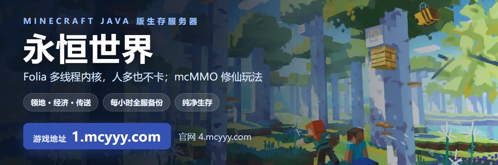

<!-- 组织主页的自述文件。组织的规矩和个人账号不同：仓库必须叫 .github 且公开，文件必须放在
     profile/README.md，这个 README 才会显示在组织主页最上方、所有仓库之前。
     横幅用的是 raw 绝对地址（组织主页对相对路径的解析不可靠），图本身也在本仓库 profile/ 下，
     换图连 profile/banner.webp 一起换即可。源文件在 HowToLiveBetter 仓库的 tools/ad-mcyyy.html，
     改完重新出图，再把 ads/mcyyy.webp 覆盖到 profile/banner.webp。 -->

全职 Minecraft 服主，运营永恒世界 8 年。

服务端、插件、官网和配套工具都自己写，日常就是把服务器跑稳、把玩法做出来、把玩家提的问题修掉。也写点和游戏无关的东西，比如《高性价比人生指南》。

### 永恒世界

Java 版生存服务器，游戏地址 `1.mcyyy.com`，官网 [4.mcyyy.com](https://4.mcyyy.com)。

| | |
| --- | --- |
| 玩法 | mcMMO 修仙、领地、经济、传送 |
| 体验 | 多线程内核，人多不卡；每小时全服备份 |
| 配套 | 官网带在线工具箱与活动页，游戏内有机器人助手 |
| 交流 | QQ 群 `8551166` |

### 公开仓库

| 仓库 | 说明 |
| --- | --- |
| [HowToLiveBetter](https://github.com/eternity4719/HowToLiveBetter)  | 高性价比人生指南。每条写明花掉什么、换回什么、证据有多硬，只引期刊论文和官方文件 |
| [CoreLib](https://github.com/eternity4719/CoreLib) | Bukkit / Folia 插件基础库，Kotlin。协程调度、持久化数据、消息与冷却的封装 |
| [AmazingBot5](https://github.com/eternity4719/AmazingBot5) | QQ 机器人框架，Bukkit 插件形态，走 OneBot 11 协议，让服务器和群互通 |
| [toh-proxy](https://github.com/eternity4719/toh-proxy) | Minecraft 服务器的 WebSocket 转发，Go |
| [TohConnect](https://github.com/eternity4719/TohConnect) | toh-proxy 的 Fabric 客户端模组，两者配套用 |
| [TrueSight](https://github.com/eternity4719/TrueSight) | Fabric 客户端模组，绕过服务端的反矿透 |
